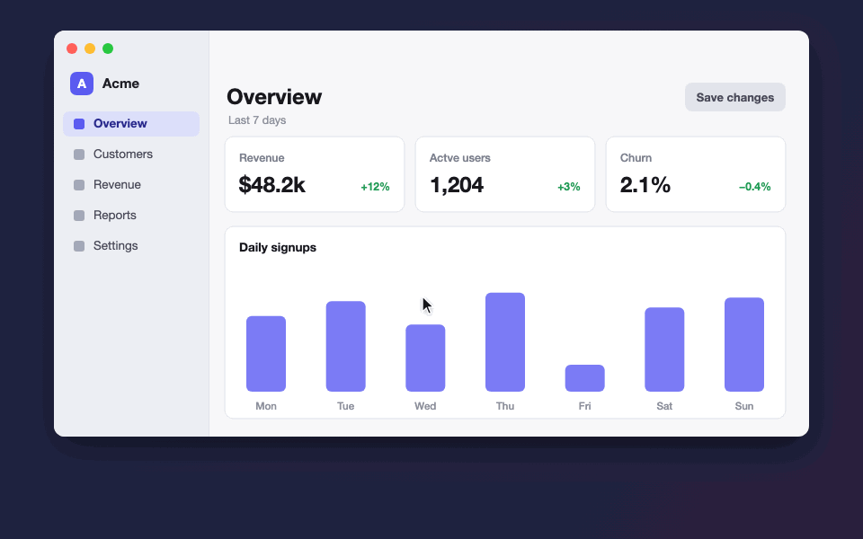

# Appshot

<p align="center"></p>

Point at your screen so your coding agent knows what you mean.

Press a shortcut, circle the thing you're talking about with a red laser pen, type what you want, and hit Return. Appshot drops the marked-up screenshot and your note into Claude or Codex for you.

No more "the button in the top right, no, the other one."

## Install

Open Terminal and paste this:

```bash
curl -fsSL https://raw.githubusercontent.com/anoojpatel/appshot/main/install.sh | zsh
```

After that, Appshot is in your Applications folder and running. You'll see a small crosshair icon in your menu bar.

Works on macOS 13 or newer, on both Apple silicon and Intel Macs.

## Permissions required

macOS will ask for these the first time you use Appshot, and only once.

1. **Screen Recording.** Lets Appshot take the screenshot. Turn it on in System Settings → Privacy & Security → Screen & System Audio Recording. Then quit Appshot from its menu and open it again. macOS needs the restart.
2. **Accessibility.** Lets Appshot paste into Claude or Codex for you. Turn it on in System Settings → Privacy & Security → Accessibility. If you skip this, Appshot still works. It just leaves the screenshot on your clipboard and you press ⌘V yourself.

To check both at any time, click the menu bar icon. Each permission shows as on or off, and clicking one that's off takes you to the right settings page.

## How to use it

1. Press **⌃⌥L** (Control + Option + L). Your screen freezes.
2. Mark what you mean:

   | Do this | You get |
   |---|---|
   | Drag | A circle or any freehand mark |
   | Hold Shift and drag | An arrow |
   | Click | A dot |
   | ⌘Z | Undo the last mark |
   | Esc | Cancel |

   Every mark gets a number, so you can write things like "make #1 match #2."
3. Type what you want the agent to do.
4. Pick where it goes: **Claude**, **Codex**, or the app you were just in (handy if you run `claude` or `codex` in a terminal).
5. Press **Return**.

Appshot switches to that app and pastes everything in. It doesn't press send, so you can read it over first.

## What the agent gets

- The screenshot with your marks drawn on it.
- Your note.
- The file path of the screenshot and where each mark is, in pixels. Something like:

  ```
  Make this button blue.

  [Appshot] Annotated screenshot: ~/Pictures/Appshot/appshot-2026-11-01T23-07-00Z.png (2940×1912 px).
  Red laser marks (pixel coords, top-left origin):
    #1 circled region x=2210 y=88 w=310 h=96
  ```

Terminals only get the text, since they can't take a pasted image. The file path is in there, and both CLIs can open it.

Every screenshot is also saved to `~/Pictures/Appshot`.

## Start a fresh CLI session instead

Click the menu bar icon and turn on **Start a new CLI session instead of pasting**. Now each shot opens a new Terminal window and starts `claude` or `codex` with your screenshot and note already loaded. You need the CLI installed for this one.

## Update or uninstall

To update, run the install command again.

To uninstall, quit Appshot from its menu, then:

```bash
rm -rf /Applications/Appshot.app ~/Pictures/Appshot
```

## Something not working?

**A permission is switched on in System Settings, but Appshot says it's off.** That switch belongs to an older copy of Appshot (v1.0.0 lost permissions on every update). Clear it and grant it again:

```bash
tccutil reset ScreenCapture local.appshot
```

```bash
tccutil reset Accessibility local.appshot
```

Then click the menu bar icon and turn each one back on. From v1.0.1, permissions stay put when you update.

**The screenshot is blank or only shows my wallpaper.** Screen Recording isn't on yet, or Appshot hasn't been restarted since you turned it on. Quit it from the menu and open it again.

**Nothing got pasted.** Accessibility isn't on. Your screenshot is on the clipboard, so press ⌘V in the chat box.

**macOS says the app can't be opened.** This happens if you downloaded the zip by hand. Run the install command above instead, or right-click Appshot.app, choose Open, then Open again.

**⌃⌥L doesn't do anything.** Another app may already use that shortcut. Click the menu bar icon and choose Capture & Annotate.

## Build it yourself

You need the Xcode Command Line Tools (`xcode-select --install`).

```bash
git clone https://github.com/anoojpatel/appshot.git
```

```bash
cd appshot && ./build.sh && open Appshot.app
```

The whole app is one Swift file, `main.swift`.
